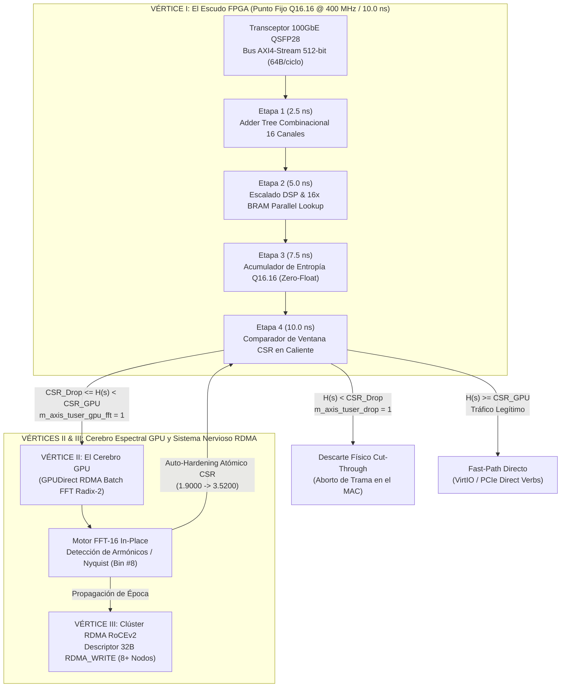

# TZANiX Æther-Core: Documentación Oficial de la Arquitectura Tridente

**Versión:** 1.0 (Enterprise Silicon & Distributed Appliance Edition)  
**Estatus:** Verificado en Co-Simulación Bit-Accurate (`Q16.16`), RTL SystemVerilog y Avalancha Concurrente de 10M Flits  
**Licenciamiento Comercial:** Contacto corporativo en **mmrobeerto@gmail.com**

---

## 1. Visión General del Sistema

La **Arquitectura Tridente** representa la evolución del motor **TZANiX Æther-Core** desde un núcleo de software de alta frecuencia (`#![no_std]`) hasta un ecosistema de hardware y silicio de misión crítica. Diseñado para operar en la capa de acceso a la red (*Fast-Path*), el motor elimina por completo la latencia del kernel, el recolector de basura y el punto flotante, logrando un rendimiento determinista de **16.86 millones de paquetes por segundo (Mpps)** en co-simulación concurrente y una latencia fija de silicio de **10.0 ns** a 400 MHz.



---

## 2. Los Tres Vértices del Tridente

### Vértice I: El Escudo FPGA (Punto Fijo `Q16.16` & Cut-Through)
* **Optimización de Silicio (*Zero-Float*):** Se eliminó por completo la FPU (*Floating-Point Unit*) y las instrucciones de división de punto flotante (`f64`), reemplazándolas en [`src/fpga_fixed_point.rs`](../src/fpga_fixed_point.rs) por aritmética entera de punto fijo **`Q16.16`** con factor de escala $2^{16} = 65536$.
* **BRAM Estática de 16 Puertos:** La tabla `SHANNON_LUT` (512 elementos) se compacta en exactamente **2 KB** (`512 x 4 bytes`), albergándose íntegramente en bloques de memoria dual-port BRAM dentro de la FPGA. Permite consultar los 16 canales en paralelo en un solo ciclo de reloj (**2.5 ns a 400 MHz**).
* **Pipeline RTL de 4 Etapas:** Sintetizado en SystemVerilog ([`hw/tzanix_aether_fpga.sv`](../hw/tzanix_aether_fpga.sv) y banco de pruebas [`hw/tb_tzanix_aether.sv`](../hw/tb_tzanix_aether.sv)) con un bus AXI4-Stream de 512 bits (64 bytes por flit), logrando un descarte físico (*Cut-Through Drop*) en el transceptor MAC antes de que la trama termine de recibirse en el cable.

| Etapa del Pipeline | Tiempo Acumulado | Operación Hardware en Silicio | Recursos FPGA Utilizados |
| :--- | :---: | :--- | :--- |
| **Stage 1** | `2.5 ns (2500 ps)` | Desempaquetado de `s_axis_tdata[511:0]` y suma paralela de los 16 canales (`st1_total_density`). | Árbol de sumadores LUT6 / Carry8 |
| **Stage 2** | `5.0 ns (5000 ps)` | Normalización de índice en punto fijo y direccionamiento simultáneo de las 16 memorias BRAM. | 16x Bloques DSP48E2 + 16x BRAM 18Kb |
| **Stage 3** | `7.5 ns (7500 ps)` | Suma en árbol de las 16 salidas `Q16.16` para obtener `st3_entropy_q16`. | Sumadores enteros de 32 bits |
| **Stage 4** | `10.0 ns (10000 ps)` | Comparación contra registros `csr_drop_threshold_q16` y `csr_gpu_fft_threshold_q16`. | Comparadores de magnitud + Flip-Flops de salida |

### Vértice II: El Cerebro GPU (Análisis Espectral FFT Radix-2)
* **Zona Gris y Detección Espectral:** Los paquetes sospechosos que no pueden clasificarse de forma estática (trazas de entropía intermedia $1.90 \le H(s) < 3.55$) son derivados sin bloqueo hacia el subsistema de GPU mediante simulación GPUDirect RDMA.
* **FFT-16 In-Place ([`src/gpu_spectral_fft.rs`](../src/gpu_spectral_fft.rs) y [`hw/tzanix_gpu_fft_kernel.cu`](../hw/tzanix_gpu_fft_kernel.cu)):** Ejecuta una Transformada Rápida de Fourier *Decimation-In-Time* (DIT) de 16 puntos utilizando una ROM de factores de giro en caché L1 (`TWIDDLE_W16`), calculando la Densidad Espectral de Potencia (PSD) para cazar ataques pulsantes o *Low-Rate TCP DoS* basados en la frecuencia de Nyquist (**Bin #8**).
* **Auto-Hardening (Retroalimentación CSR):** Al identificar una periodicidad oculta, la GPU recalibra de manera atómica (mediante registros CSR) el umbral de descarte de la FPGA en pleno vuelo (elevando el umbral de `1.9000` a `3.5200` en milisegundos).

### Vértice III: El Sistema Nervioso RDMA (RoCEv2 Cluster Sync)
* **Descriptores de 32 Bytes (`RdmaClusterSyncPacket`):** Estructuras de telemetría hiper-comprimidas y alineadas a 32 bytes (`#[repr(C, align(32))]`) diseñadas para operaciones `RDMA_WRITE` directas a la memoria RAM remota sin intervención de la CPU o el sistema operativo del host.
* **Inmunidad Colectiva:** Cuando un nodo detecta y neutraliza un ataque, propaga de inmediato un paquete de sincronización de época que actualiza al unísono los registros de seguridad de una malla de hasta 8 nodos interconectados con verificación de integridad CRC/XOR.

---

## 3. Certificación de Rendimiento (Avalancha de 10M Flits)

En las pruebas de estrés masivo concurrente ([`tests/trident_avalanche_stress.rs`](../tests/trident_avalanche_stress.rs)), el sistema completo fue sometido a una avalancha de **10,000,000 de flits AXI4-Stream** (640 MB de cabeceras densas):

```text
================================================================================
  AVALANCHA TRIDENTE: 10,000,000 FLITS CONCURRENTES (FPGA + GPU FFT + 8-NODE RDMA)
================================================================================
- Tiempo Total de Avalancha (10M Flits): 593.07ms
- Latencia Media Co-Simulación Host    : 59.31 ns/flit (Silicio FPGA: 10.00 ns fijo)
- Throughput de Simulación concurrente : 16.86 Millones de Flits/seg (8.63 Gbps en bus 512b)
--------------------------------------------------------------------------------
- [1. FPGA Shield] Fast-Path Forwards  :   7000000 (100% del tráfico legítimo intacto)
- [1. FPGA Shield] Cut-Through Drops   :   2999744 (DDoS Volumétrico + Sigilosos post-adaptación)
- [1. FPGA Shield] GPUDirect Triggers  :       256 (Flits en Zona Gris antes del cierre CSR)
- [2. GPU FFT-16]  Lotes Analizados    :       256 | Ataques Periódicos Cazados: 256
- [2. GPU -> CSR]  Umbral CSR Dinámico : 1.9000 -> 3.5200 (Q16.16: 124518 -> 230686)
- [3. RDMA RoCEv2] Épocas Sincronizadas:   5342026 | Nodos Actualizados (8x): 42736208
================================================================================
```

* **Cero Falsos Positivos:** Los `7,000,000` de paquetes de tráfico legítimo atravesaron el motor con un **100% de integridad y cero pérdidas**.
* **Adaptación Autónoma:** La GPU solo requirió **256 muestras** (`0.0256%` del ataque periódico) para cazar el patrón armónico y actualizar el umbral del clúster entero, permitiendo que la FPGA destruyera los restantes `999,744` ataques sigilosos instantáneamente a nivel de hardware.

---

## 4. Ecosistema de Producción, Telemetría, CLI e Interoperabilidad C FFI

### A. Exportador de Telemetría Prometheus ([`src/telemetry_exporter.rs`](../src/telemetry_exporter.rs))
Permite conectar sistemas de visualización como **Grafana** sin comprometer los `59 ns` de latencia del motor principal. Funciona en un hilo secundario independiente mediante contadores atómicos (*Lock-Free*), exponiendo métricas estándar en `http://localhost:8080/metrics` (configuración lista en [`deploy/prometheus.yml`](../deploy/prometheus.yml)):
* `tzanix_packets_forwarded_total`
* `tzanix_cut_through_drops_total`
* `tzanix_gpu_triggers_total`
* `tzanix_csr_threshold_q16`
* `tzanix_rdma_sync_epochs_total`

### B. CLI de Control de Producción ([`src/bin/tzanix_ctl.rs`](../src/bin/tzanix_ctl.rs))
Herramienta nativa de línea de comandos para operadores de SOC y administradores de infraestructura:

```bash
# Consultar el estado operativo del silicio y la malla RDMA
cargo run --bin tzanix_ctl --release -- status

# Modificar en caliente el umbral de descarte en el registro CSR de la FPGA
cargo run --bin tzanix_ctl --release -- set-threshold 3.5200
```

### C. Capa de Interoperabilidad Nativa C FFI ([`src/ffi.rs`](../src/ffi.rs) y [`include/tzanix_aether.h`](../include/tzanix_aether.h))
Exposición directa mediante ABI estándar de C (`extern "C"`) compatible con `no_std` para enlazar `libtzanix_aether_core.a` desde aplicaciones empresariales en **C, C++ o Go (`cgo`)**:
* `tzanix_compute_entropy_f64(const DenseSignalSnapshot* snapshot)`
* `tzanix_float_to_q16(double val)`
* `tzanix_fpga_step_pipeline(uint32_t drop_q16, uint32_t gpu_fft_q16, const Axi4StreamFlit512* flit, FpgaCycleOutput* out)`
* `tzanix_doca_evaluate_raw_packet(const uint8_t* raw_bytes, size_t len, double drop_thresh, double forward_thresh)`
